---
# Feel free to add content and custom Front Matter to this file.
# To modify the layout, see https://jekyllrb.com/docs/themes/#overriding-theme-defaults

title: Epsilon Emerald
layout: default
---

# Encounter Tables

This details, for the most part, the encounter tables for every map in the game. It's a work-in-progress and will be updated with additional detail later.

> Note: Pokémon in the 'Hidden' category are not catchable until becoming Champion and acquiring the National Pokédex.

## Route 101

| Environment | Encounters | Notes |
| ----------- | ---------- | ----- |
| Land | 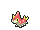 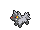 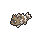 | |
| Hidden | 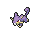 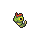 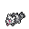 | |

## Route 102

| Environment | Encounters | Notes |
| ----------- | ---------- | ----- |
| Land |   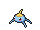 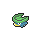  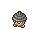 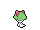 | |
| Water | 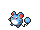  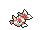 | |
| Fishing | 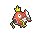  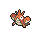 | |
| Hidden |  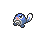 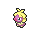 | |

## Route 103

| Environment | Encounters | Notes |
| ----------- | ---------- | ----- |
| Land |  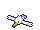 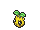  | |
| Water | 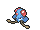  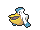 | |
| Fishing |   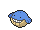 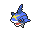 | |
| Hidden | 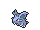 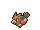  | |

## Route 104

| Environment | Encounters | Notes |
| ----------- | ---------- | ----- |
| Land |   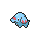  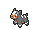 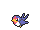  | |
| Water |   | |
| Fishing |  | |
| Hidden |  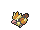 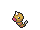 | |

## Route 105

| Environment | Encounters | Notes |
| ----------- | ---------- | ----- |
| Water |    | |
| Fishing |    | |
| Hidden | 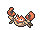 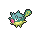 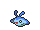 | |

## Route 106

| Environment | Encounters | Notes |
| ----------- | ---------- | ----- |
| Water |    | |
| Fishing |    | |
| Hidden |    | |

## Route 107

| Environment | Encounters | Notes |
| ----------- | ---------- | ----- |
| Water |    | |
| Fishing |    | |
| Hidden |    | |

## Route 108

| Environment | Encounters | Notes |
| ----------- | ---------- | ----- |
| Water |  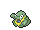   | |
| Fishing |    | |
| Hidden |    | |

## Route 109

| Environment | Encounters | Notes |
| ----------- | ---------- | ----- |
| Water |    | |
| Fishing |    | |
| Hidden |    | |

## Route 110

| Environment | Encounters | Notes |
| ----------- | ---------- | ----- |
| Land |  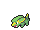 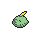 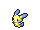 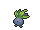  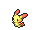 | |
| Water |    | |
| Fishing |    | |
| Hidden | 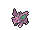 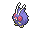 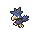 | |

## Route 111

| Environment | Encounters | Notes |
| ----------- | ---------- | ----- |
| Land | 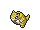 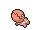  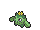 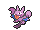 | |
| Water |  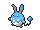  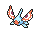 | |
| Fishing |   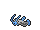 | |
| Rock Smash | 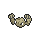 | |
| Hidden | 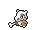   | |

## Route 112

| Environment | Encounters | Notes |
| ----------- | ---------- | ----- |
| Land |    | |
| Hidden |    | |

## Route 113

| Environment | Encounters | Notes |
| ----------- | ---------- | ----- |
| Land |      | |
| Hidden |    | |

## Route 114

| Environment | Encounters | Notes |
| ----------- | ---------- | ----- |
| Land |        | |
| Water |    | |
| Fishing |    | |
| Rock Smash |  | |
| Hidden |    | |

## Route 115

| Environment | Encounters | Notes |
| ----------- | ---------- | ----- |
| Land |     | |
| Water |    | |
| Fishing |    | |
| Hidden |    | |

## Route 116

| Environment | Encounters | Notes |
| ----------- | ---------- | ----- |
| Land |        | |
| Hidden |    | |

## Route 117

| Environment | Encounters | Notes |
| ----------- | ---------- | ----- |
| Land |        | |
| Water |    | |
| Fishing |     | |
| Hidden |    | |

## Route 118

| Environment | Encounters | Notes |
| ----------- | ---------- | ----- |
| Land |       | |
| Water |    | |
| Fishing |     | |
| Hidden |    | |

## Route 119

| Environment | Encounters | Notes |
| ----------- | ---------- | ----- |
| Land |         | |
| Water |    | |
| Fishing |    | |
| Hidden |    | |

## Route 120

| Environment | Encounters | Notes |
| ----------- | ---------- | ----- |
| Land |         | |
| Water |    | |
| Fishing |    | |
| Hidden |    | |

## Route 121

| Environment | Encounters | Notes |
| ----------- | ---------- | ----- |
| Land |        | |
| Water |    | |
| Fishing |    | |
| Hidden |    | |

## Route 122

| Environment | Encounters | Notes |
| ----------- | ---------- | ----- |
| Water |     | |
| Fishing |      | |
| Hidden |    | |

## Route 123

| Environment | Encounters | Notes |
| ----------- | ---------- | ----- |
| Land |        | |
| Water |     | |
| Fishing |     | |

## Route 123 Berry Masters Garden

| Environment | Encounters | Notes |
| ----------- | ---------- | ----- |
| Land |        | |
| Hidden |    | |

## Route 124

| Environment | Encounters | Notes |
| ----------- | ---------- | ----- |
| Water |     | |
| Fishing |     | |
| Hidden |    | |

## Underwater Route 124

| Environment | Encounters | Notes |
| ----------- | ---------- | ----- |
| Water |     | |

## Route 125

| Environment | Encounters | Notes |
| ----------- | ---------- | ----- |
| Water |    | |
| Fishing |     | |
| Hidden |    | |

## Underwater Route 126

| Environment | Encounters | Notes |
| ----------- | ---------- | ----- |
| Water |     | |

## Route 126

| Environment | Encounters | Notes |
| ----------- | ---------- | ----- |
| Water |    | |
| Fishing |     | |
| Hidden |    | |

## Route 127

| Environment | Encounters | Notes |
| ----------- | ---------- | ----- |
| Water |    | |
| Fishing |     | |
| Hidden |    | |

## Route 128

| Environment | Encounters | Notes |
| ----------- | ---------- | ----- |
| Water |    | |
| Fishing |      | |
| Hidden |    | |

## Route 129

| Environment | Encounters | Notes |
| ----------- | ---------- | ----- |
| Water |     | |
| Fishing |     | |
| Hidden |    | |

## Route 130

| Environment | Encounters | Notes |
| ----------- | ---------- | ----- |
| Land |  | |
| Water |    | |
| Fishing |      | |
| Hidden |    | |

## Underwater Route 130

| Environment | Encounters | Notes |
| ----------- | ---------- | ----- |
| Water |     | |

## Route 131

| Environment | Encounters | Notes |
| ----------- | ---------- | ----- |
| Water |    | |
| Fishing |      | |
| Hidden |    | |

## Route 132

| Environment | Encounters | Notes |
| ----------- | ---------- | ----- |
| Water |    | |
| Fishing |       | |
| Hidden |    | |

## Route 133

| Environment | Encounters | Notes |
| ----------- | ---------- | ----- |
| Water |    | |
| Fishing |       | |
| Hidden |    | |

## Route 134

| Environment | Encounters | Notes |
| ----------- | ---------- | ----- |
| Water |    | |
| Fishing |       | |
| Hidden |    | |

## Abandoned Ship

| Environment | Encounters | Notes |
| ----------- | ---------- | ----- |
| Water |   | |
| Fishing |    | |

## Altering Cave

| Environment | Encounters | Notes |
| ----------- | ---------- | ----- |
| Hidden |    | More is planned for 1.1 |

## Aqua Hideout

| Environment | Encounters | Notes |
| ----------- | ---------- | ----- |
| Water |  | |
| Fishing |     | |

## Artisan Cave

| Environment | Encounters | Notes |
| ----------- | ---------- | ----- |
| Land |  | |

## Battle Frontier

| Environment | Encounters | Notes |
| ----------- | ---------- | ----- |
| Water |     | |
| Fishing |     | |

## Cave Of Origin 1F

| Environment | Encounters | Notes |
| ----------- | ---------- | ----- |
| Land |     | |
| Hidden |    | |

## Cave Of Origin Entrance

| Environment | Encounters | Notes |
| ----------- | ---------- | ----- |
| Land |   | |
| Hidden |    | |

## Dewford Shore

| Environment | Encounters | Notes |
| ----------- | ---------- | ----- |
| Land |        | |
| Water |    | |
| Fishing |     | |
| Hidden |    | |

## Dewford Town

| Environment | Encounters | Notes |
| ----------- | ---------- | ----- |
| Water |    | |
| Fishing |    | |

## Ever Grande City

| Environment | Encounters | Notes |
| ----------- | ---------- | ----- |
| Water |    | |
| Fishing |      | |

## Fiery Path

| Environment | Encounters | Notes |
| ----------- | ---------- | ----- |
| Land |       | |
| Hidden |    | |

## Granite Cave 1F

| Environment | Encounters | Notes |
| ----------- | ---------- | ----- |
| Land |     | |
| Rock Smash |   | |
| Hidden |    | |

## Granite Cave B1F

| Environment | Encounters | Notes |
| ----------- | ---------- | ----- |
| Land |      | |
| Hidden |    | |

## Granite Cave B2F

| Environment | Encounters | Notes |
| ----------- | ---------- | ----- |
| Land |      | |
| Rock Smash |   | |
| Hidden |    | |

## Granite Cave (Steven's Room)

| Environment | Encounters | Notes |
| ----------- | ---------- | ----- |
| Land |     | |
| Hidden |    | |

## Ice Oasis

| Environment | Encounters | Notes |
| ----------- | ---------- | ----- |
| Land |      | |
| Hidden |    | |

## Jagged Pass

| Environment | Encounters | Notes |
| ----------- | ---------- | ----- |
| Land |     | |
| Hidden |    | |

## Lilycove City

| Environment | Encounters | Notes |
| ----------- | ---------- | ----- |
| Water |    | |
| Fishing |     | |

## Magma Hideout

| Environment | Encounters | Notes |
| ----------- | ---------- | ----- |
| Land |    | |

## Mauville City 3F

| Environment | Encounters | Notes |
| ----------- | ---------- | ----- |
| Land |          | |
| Hidden |    | |

## Meteor Falls 1F 1R

| Environment | Encounters | Notes |
| ----------- | ---------- | ----- |
| Land |    | |
| Water |    | |
| Fishing |      | |
| Hidden |    | |

## Meteor Falls 1F 2R

| Environment | Encounters | Notes |
| ----------- | ---------- | ----- |
| Land |    | |
| Water |   | |
| Fishing |       | |
| Hidden |    | |

## Meteor Falls B1F 1R

| Environment | Encounters | Notes |
| ----------- | ---------- | ----- |
| Land |    | |
| Water |    | |
| Fishing |       | |
| Hidden |    | |

## Meteor Falls B1F 2R

| Environment | Encounters | Notes |
| ----------- | ---------- | ----- |
| Land |     | |
| Water |    | |
| Fishing |        | |
| Hidden |    | |

## Meteor Falls (Steven's Cave)

| Environment | Encounters | Notes |
| ----------- | ---------- | ----- |
| Land |     | |
| Hidden |    | |

## Mossdeep City

| Environment | Encounters | Notes |
| ----------- | ---------- | ----- |
| Water |    | |
| Fishing |     | |

## Mt Pyre 1F

| Environment | Encounters | Notes |
| ----------- | ---------- | ----- |
| Land |  | |

## Mt Pyre 2F

| Environment | Encounters | Notes |
| ----------- | ---------- | ----- |
| Land |  | |

## Mt Pyre 3F

| Environment | Encounters | Notes |
| ----------- | ---------- | ----- |
| Land |  | |

## Mt Pyre 4F

| Environment | Encounters | Notes |
| ----------- | ---------- | ----- |
| Land |   | |

## Mt Pyre 5F

| Environment | Encounters | Notes |
| ----------- | ---------- | ----- |
| Land |   | |

## Mt Pyre 6F

| Environment | Encounters | Notes |
| ----------- | ---------- | ----- |
| Land |   | |

## Mt Pyre Exterior

| Environment | Encounters | Notes |
| ----------- | ---------- | ----- |
| Land |      | |
| Hidden |    | |

## Mt Pyre Summit

| Environment | Encounters | Notes |
| ----------- | ---------- | ----- |
| Land |    | |
| Hidden |    | |

## New Mauville Entrance

| Environment | Encounters | Notes |
| ----------- | ---------- | ----- |
| Land |    | |

## New Mauville Inside

| Environment | Encounters | Notes |
| ----------- | ---------- | ----- |
| Land |       | |

## Pacifidlog Town

| Environment | Encounters | Notes |
| ----------- | ---------- | ----- |
| Water |    | |
| Fishing |     | |

## Petalburg City

| Environment | Encounters | Notes |
| ----------- | ---------- | ----- |
| Water |     | |
| Fishing |    | |

## Petalburg Woods

| Environment | Encounters | Notes |
| ----------- | ---------- | ----- |
| Land |        | |
| Hidden |    | |

## Rusturf Tunnel

| Environment | Encounters | Notes |
| ----------- | ---------- | ----- |
| Land |    | |

## Safari Zone North

| Environment | Encounters | Notes |
| ----------- | ---------- | ----- |
| Land |       | |
| Rock Smash |  | |

## Safari Zone Northeast

| Environment | Encounters | Notes |
| ----------- | ---------- | ----- |
| Land |         | Only accessible postgame |
| Rock Smash |  | |

## Safari Zone Northwest

| Environment | Encounters | Notes |
| ----------- | ---------- | ----- |
| Land |       | |
| Water |   | |
| Fishing |    | |

## Safari Zone South

| Environment | Encounters | Notes |
| ----------- | ---------- | ----- |
| Land |        | |

## Safari Zone Southeast

| Environment | Encounters | Notes |
| ----------- | ---------- | ----- |
| Land |         | Only accessible postgame |
| Water |    | |
| Fishing |     | |

## Safari Zone Southwest

| Environment | Encounters | Notes |
| ----------- | ---------- | ----- |
| Land |        | |
| Water |  | |
| Fishing |    | |

## Seafloor Cavern

| Environment | Encounters | Notes |
| ----------- | ---------- | ----- |
| Land |   | |
| Water |    | |
| Fishing |    | |

## Shoal Cave Low Tide Entrance Room

| Environment | Encounters | Notes |
| ----------- | ---------- | ----- |
| Land |    | |
| Water |    | |
| Fishing |    | |
| Hidden |    | |

## Shoal Cave Low Tide Ice Room

| Environment | Encounters | Notes |
| ----------- | ---------- | ----- |
| Land |     | |

## Shoal Cave Low Tide Inner Room

| Environment | Encounters | Notes |
| ----------- | ---------- | ----- |
| Land |    | |
| Water |    | |
| Fishing |    | |
| Hidden |    | |

## Shoal Cave Low Tide Lower Room

| Environment | Encounters | Notes |
| ----------- | ---------- | ----- |
| Land |    | |
| Hidden |    | |

## Shoal Cave Low Tide Stairs Room

| Environment | Encounters | Notes |
| ----------- | ---------- | ----- |
| Land |    | |
| Hidden |    | |

## Sky Pillar 1F

| Environment | Encounters | Notes |
| ----------- | ---------- | ----- |
| Land |     | |

## Sky Pillar 3F

| Environment | Encounters | Notes |
| ----------- | ---------- | ----- |
| Land |     | |

## Sky Pillar 5F

| Environment | Encounters | Notes |
| ----------- | ---------- | ----- |
| Land |      | |

## Slateport City

| Environment | Encounters | Notes |
| ----------- | ---------- | ----- |
| Land |      | |
| Water |    | |
| Fishing |    | |

## Sootopolis City

| Environment | Encounters | Notes |
| ----------- | ---------- | ----- |
| Water |  | |
| Fishing |    | |

## Victory Road 1F

| Environment | Encounters | Notes |
| ----------- | ---------- | ----- |
| Land |         | |

## Victory Road B1F

| Environment | Encounters | Notes |
| ----------- | ---------- | ----- |
| Land |     | |
| Rock Smash |   | |

## Victory Road B2F

| Environment | Encounters | Notes |
| ----------- | ---------- | ----- |
| Land |      | |
| Water |  | |
| Fishing |     | |

## Desert Underpass

| Environment | Encounters | Notes |
| ----------- | ---------- | ----- |
| Land |     | |

## Mirage Forest

| Environment | Encounters | Notes |
| ----------- | ---------- | ----- |
| Land |   | |

## Mirage Island (Route 125)

| Environment | Encounters | Notes |
| ----------- | ---------- | ----- |
| Land |   | |
| Rock Smash |   | |

## Mirage Mountain

| Environment | Encounters | Notes |
| ----------- | ---------- | ----- |
| Land |    | |

## Mirage Tower

| Environment | Encounters | Notes |
| ----------- | ---------- | ----- |
| Land |     | |
