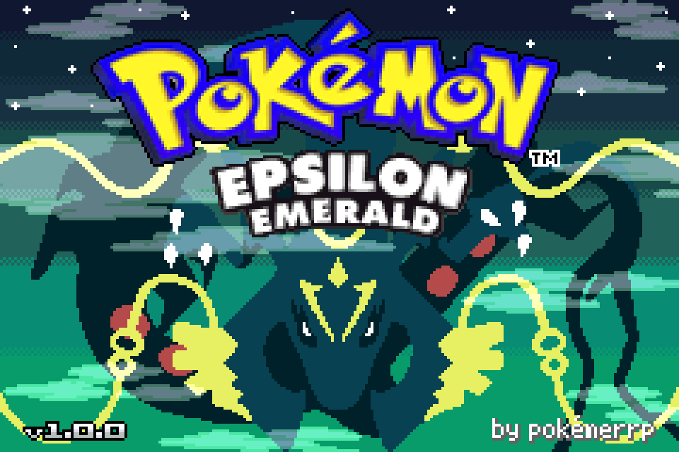
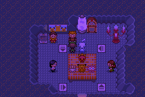
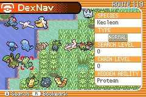
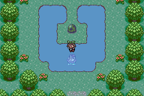
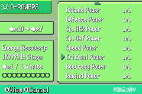
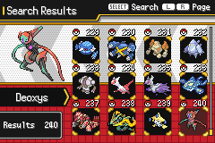
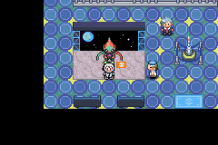
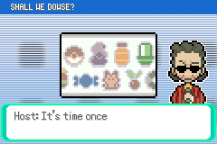
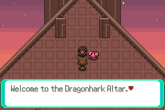
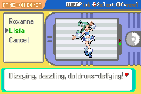

---
# Feel free to add content and custom Front Matter to this file.
# To modify the layout, see https://jekyllrb.com/docs/themes/#overriding-theme-defaults

title: Epsilon Emerald
layout: default
---

    

|     |     |     |
| :-: | :-: | :-: |
|  |  |  |
|  |  |  |
|  |  |  |

## Disclaimer

To the best of my efforts and knowledge, this romhack is **free of AI**, generative or otherwise, and is an entirely organic, human effort.
I do not use LLMs for code, research, artwork, assets, or otherwise.

> Note: This romhack incorporates several branches maintained by others.
> I've done my best to ensure those are organic as well--let me know if I've erred!

If you're interested in contributing to organic romhack development, please check out:

[https://github.com/friend-safari](https://github.com/friend-safari)

## Docs

[Items](./items) | [Encounters](./encounters) | [Move/Mon changes](https://docs.google.com/document/d/1xMMhLrBNf2X11aAbVOAPCpD5rZ4scWPLGabgiRGTu4Y/edit?usp=sharing) (Thanks to my friend Millie!) | [FAQ](./FAQ)

## Features

### General

- [Following/walking Pokemon](https://bulbapedia.bulbagarden.net/wiki/Walking_Pok%C3%A9mon)
    - Originally coded by me
    - Supports hundreds of conditional messages, every type of Poké Ball, and [Shiny Leaves](https://bulbapedia.bulbagarden.net/wiki/Shiny_Leaf)
- Day/night lighting, effects, and encounters
- Gen 6-7 style icons everywhere (including the PC!), with shiny support
- Three difficulty settings:
	- Easy, which imposes no additional challenge
	- Normal, which forces SET style and only allows up to two items per battle from the Bag
	- Hard, which is like Normal, but allows zero items from the Bag, and trainers' parties scale with your party's level
- Reworked teams for every trainer in the game
- Soft level caps (for Normal & Hard), scaling with # of badges (diminishing EXP returns)
- Built-in Nuzlocke mode (See intern in Prof. Birch's lab)
- Built on [RHH's Pokemon expansion](https://github.com/rh-hideout/pokeemerald-expansion)
- Updated battle mechanics
- Detailed Pokédex with evolution methods, learnsets, fast paging, etc.
- Decapitalized text
- Modern TM/HM mechanics: TMs are reusable, HMs can be used without being taught
- Toggleable Exp. Share
- Hyper Training / Bottle Caps
- Mystery Gift Wonder Card (and Wonder Code) input for event distribution
- [DexNav](https://bulbapedia.bulbagarden.net/wiki/DexNav)
- [Fame Checker](https://bulbapedia.bulbagarden.net/wiki/Fame_Checker) ported from FireRed / LeafGreen
- [Super-Secret Bases](https://bulbapedia.bulbagarden.net/wiki/Secret_Base#Generation_VI)
    - Compatible with vanilla
    - Added locations across Hoenn
    - Shareable with others via mGBA savestate
    - Dozens of new, **functional** decorations (Berry Pot, Berry Blender, Pinball Machine)
    - In-game Secret Bases featuring the Mauville [Old Guys](https://bulbapedia.bulbagarden.net/wiki/Old_guys)
- [Pokemon Memories](https://bulbapedia.bulbagarden.net/wiki/Memory_(game_mechanic)), retained during trades
- Dozens of new or newly arranged music tracks and artwork

### ORAS

These are features based on or inspired by Omega Ruby / Alpha Sapphire:

- Complete, playable [Delta Episode](https://bulbapedia.bulbagarden.net/wiki/Delta_Episode)
- ORAS NPC changes and additions: Prof. Cozmo, Aarune, Lisia, Zinnia, etc.
- [Soaring](https://bulbapedia.bulbagarden.net/wiki/Soaring_in_the_sky) via Latias or Latios, also includes [Mirage Spots](https://bulbapedia.bulbagarden.net/wiki/Mirage_spot)
- Mega Evolution & [Spectacular Talents](https://bulbapedia.bulbagarden.net/wiki/Appeal#Spectacular_Talent) may be performed in Contests
- [Cosplay Pikachu](https://bulbapedia.bulbagarden.net/wiki/Cosplay_Pikachu), with updated types and abilities
- Sidequests involving Lisia, Chaz, and Wallace in Contests
- Sidequest to acquire a gear-switching Bike in postgame, the Machro Bike
- Register up to four Key Items at once
- Enhanced TV shows / [BuzzNav](https://bulbapedia.bulbagarden.net/wiki/Pok%C3%A9Nav_Plus#BuzzNav)
- A postgame location in Rustboro for EV and level-up training
- New locations near Route 111, Dewford Town, and more!
- Custom Mega Evolution for Milotic
- Wally can be rematched in the Battle Frontier's Ranking Hall

### QOL

No romhack is complete these days without plenty of quality-of-life features:

- Text speed improvements: Doubled speed for 'Fast', hold A & B to advance automatically
- Fewer repeated NPC interactions (no more talking to Nurse Joy twice by mistake)
- 'Organize Boxes' is first in the PC
- Increased Battle Frontier BP rewards
- Level 100 Pokémon may still evolve via Rare Candy
- Faster repeated Berry interactions & increased Berry yields
- Faster medicine usage (hold A), an auto-heal button (press Start)
- Reduced text when rematching a trainer after whiting out
- Single-use move tutors are now once per day
- X/Y-style [Berry mutations](https://bulbapedia.bulbagarden.net/wiki/Berry_fields_(Kalos)#Mutation)
- Almost every item can be acquired repeatably
- More move tutors: Mauville, Sootopolis, and Meteor Falls
- Match Calls from random trainers can be muted
- Alternate evolution methods for regional forms (see Pokédex for details)
- Change player name or gender via your bedroom's mirror
- Fly to Routes, not just towns or cities
- View landmarks, Berries, and Secret Bases in the PokéNav map
- Show type effectiveness in battle
- Modernized breeding mechanics
- RNG options: vanilla (zero-seeded), or RTC-seeded
- Bag pocket sorting and paging; increased pocket size
- Unlimited Pokéblock sheen limits
- A timer item for the idle hatching of Eggs (also calls `SeedRng(gMain.vblankCounter1)`)
- Static Feebas tile locations like ORAS (if fishing up dynamically, a Prism Scale is held 100% of the time)
- Known vanilla bugs fixed, except the fun ones ;)
- Crash handler & error reporting screen
- Higher-quality audio using [ipatix's mixer](https://github.com/pret/pokeemerald/wiki/Implementing-ipatix's-High-Quality-Audio-Mixer)

### Miscellaneous

Most people may not notice or care about these, but they're here anyway:

- GameCube compatibility. Connect to Pokémon Colosseum, XD, or Channel (can even receive Jirachi!)
- Poison no longer damages Pokémon with Poison Heal
- Shuckle makes Berry Juice
- Devon Corp can also revive fossils not native to Hoenn
- Many cosmetic improvements and tile errors fixed
- Various easter eggs

## Credits

[See here](./credits.md)

## Discord

[https://discord.gg/BrDExuuFVY](https://discord.gg/BrDExuuFVY)
