---
# Feel free to add content and custom Front Matter to this file.
# To modify the layout, see https://jekyllrb.com/docs/themes/#overriding-theme-defaults

title: Epsilon Emerald
layout: default
---

<p align="center">
    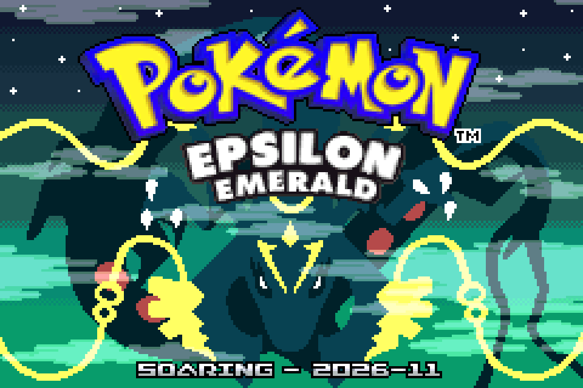
</p>

|     |     |     |
| :-: | :-: | :-: |
| 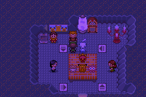 | 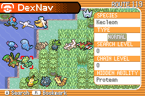 | 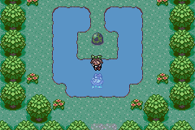 |
| 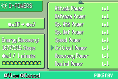 | 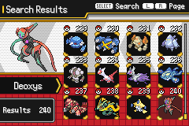 | 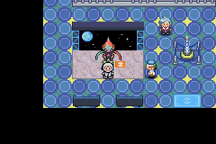 |
| 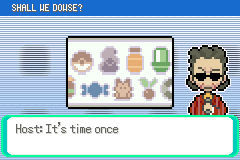 | 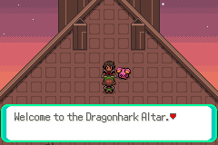 | 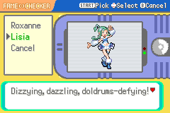 |

<p align="center">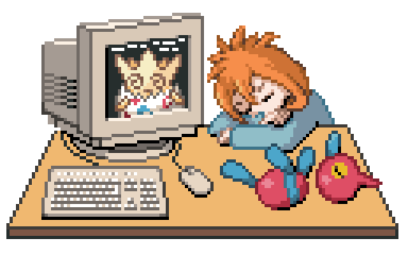</p>

<p align="center">Under Construction</p>

## Disclaimer

To the best of my knowledge, this romhack is **free of AI**, generative or otherwise, and is an entirely organic, human effort. I do not use LLMs for code, research, artwork, assets, or otherwise.

> Note: This romhack incorporates several branches maintained by others.
> I've done my best to ensure those are organic as well.

If you're interested in contributing to organic romhack development, please check out:

[https://github.com/friend-safari](https://github.com/friend-safari)

## Features

### General

- [Following/walking Pokemon](https://bulbapedia.bulbagarden.net/wiki/Walking_Pok%C3%A9mon)
    - Originally coded by me
    - Supports hundreds of conditional messages, every type of Poké Ball, and [Shiny Leaves](https://bulbapedia.bulbagarden.net/wiki/Shiny_Leaf)

- Day/night lighting, effects, and encounters
- Gen 6-7 style icons everywhere (including the PC!), with shiny support
- Three difficulty settings:
	- Easy, which imposes no additional challenge
	- Normal, which forces SET style and only allows up to two items per battle from the Bag
	- Hard, which is like Normal, but allows zero items from the Bag, and trainers' parties scale with your party's level
- Reworked teams for every trainer in the game
- Soft level caps (for Normal & Hard), scaling with # of badges (diminishing EXP returns)
- Built-in Nuzlocke mode (See intern in Prof. Birch's lab)
- Built on [RHH's Pokemon expansion](https://github.com/rh-hideout/pokeemerald-expansion)
- Updated battle mechanics
- Detailed Pokédex with evolution methods, learnsets, fast paging, etc.
- Decapitalized text
- Modern TM/HM mechanics: TMs are reusable, HMs can be used without being taught
- Toggleable Exp. Share
- Hyper Training / Bottle Caps
- Mystery Gift Wonder Card (and Wonder Code) input for event distribution
- [DexNav](https://bulbapedia.bulbagarden.net/wiki/DexNav)
- [Fame Checker](https://bulbapedia.bulbagarden.net/wiki/Fame_Checker) ported from FireRed / LeafGreen
- [Super-Secret Bases](https://bulbapedia.bulbagarden.net/wiki/Secret_Base#Generation_VI)
    - Compatible with vanilla
    - Added locations across Hoenn
    - Shareable with others via mGBA savestate
    - Dozens of new, **functional** decorations (Berry Pot, Berry Blender, Pinball Machine)
    - In-game Secret Bases featuring the Mauville [Old Guys](https://bulbapedia.bulbagarden.net/wiki/Old_guys)
- [Pokemon Memories](https://bulbapedia.bulbagarden.net/wiki/Memory_(game_mechanic)), retained during trades
- Dozens of new or newly arranged music tracks and artwork

### ORAS

These are features based on or inspired by Omega Ruby / Alpha Sapphire:

- Complete, playable [Delta Episode](https://bulbapedia.bulbagarden.net/wiki/Delta_Episode)
- ORAS NPC changes and additions: Prof. Cozmo, Aarune, Lisia, Zinnia, etc.
- [Soaring](https://bulbapedia.bulbagarden.net/wiki/Soaring_in_the_sky) via Latias or Latios, also includes [Mirage Spots](https://bulbapedia.bulbagarden.net/wiki/Mirage_spot)
- Mega Evolution & [Spectacular Talents](https://bulbapedia.bulbagarden.net/wiki/Appeal#Spectacular_Talent) may be performed in Contests
- [Cosplay Pikachu](https://bulbapedia.bulbagarden.net/wiki/Cosplay_Pikachu), with updated types and abilities
- Sidequests involving Lisia, Chaz, and Wallace in Contests
- Sidequest to acquire a gear-switching Bike in postgame, the Machro Bike
- Register up to four Key Items at once
- Enhanced TV shows / [BuzzNav](https://bulbapedia.bulbagarden.net/wiki/Pok%C3%A9Nav_Plus#BuzzNav)
- A postgame location in Rustboro for EV and level-up training
- New locations near Route 111, Dewford Town, and more!
- Custom Mega Evolution for Milotic
- Wally can be rematched in the Battle Frontier's Ranking Hall

### QOL

No romhack is complete these days without plenty of quality-of-life features:

- Text speed improvements: Doubled speed for 'Fast', hold A & B to advance automatically
- Fewer repeated NPC interactions (no more talking to Nurse Joy twice by mistake)
- 'Organize Boxes' is first in the PC
- Increased Battle Frontier BP rewards
- Level 100 Pokémon may still evolve via Rare Candy
- Faster repeated Berry interactions & increased Berry yields
- Faster medicine usage (hold A), an auto-heal button (press Start)
- Reduced text when rematching a trainer after whiting out
- Single-use move tutors are now once per day
- X/Y-style [Berry mutations](https://bulbapedia.bulbagarden.net/wiki/Berry_fields_(Kalos)#Mutation)
- Almost every item can be acquired repeatably
- More move tutors: Mauville, Sootopolis, and Meteor Falls
- Match Calls from random trainers can be muted
- Alternate evolution methods for regional forms (see Pokédex for details)
- Change player name or gender via your bedroom's mirror
- Fly to Routes, not just towns or cities
- View landmarks, Berries, and Secret Bases in the PokéNav map
- Show type effectiveness in battle
- Modernized breeding mechanics
- RNG options: vanilla (zero-seeded), or RTC-seeded
- Bag pocket sorting and paging; increased pocket size
- Unlimited Pokéblock sheen limits
- A timer item for the idle hatching of Eggs (also calls `SeedRng(gMain.vblankCounter1)`)
- Static Feebas tile locations like ORAS (if fishing up dynamically, a Prism Scale is held 100% of the time)
- Known vanilla bugs fixed, except the fun ones ;)
- Crash handler & error reporting screen
- Higher-quality audio using [ipatix's mixer](https://github.com/pret/pokeemerald/wiki/Implementing-ipatix's-High-Quality-Audio-Mixer)

### Miscellaneous

Most people may not notice or care about these, but they're here anyway:

- GameCube compatibility. Connect to Pokémon Colosseum, XD, or Channel (can even receive Jirachi!)
- Poison no longer damages Pokémon with Poison Heal
- Shuckle makes Berry Juice
- Devon Corp can also revive fossils not native to Hoenn
- Many cosmetic improvements and tile errors fixed
- Various easter eggs

## FAQ

Q: So when can I play it?

A: Soon. This November! Early November! I'm polishing things up as you read this, most likely.

---

Q: So how can I play it?

A: You'll need an [emulator](https://mgba.io/) and a copy of the base Pokémon Emerald ROM.
You'll be able to use the patcher included on this site, or download a `.BPS` patch and patch it locally.

---

Q: Which Pokémon are included?

A: All 386 species from Generations 1-3, any regional forms, evolutions, and Mega Evolutions of those 386, Riolu & Lucario, and... something secret.

This means, for example, that Roserade, Alolan Ninetales, Sirfetch'd, Annihilape, etc are present, but not convergent species like Wugtrio.

This is partly philosophical (I don't believe 1000+ Pokémon fit into Hoenn) and partly practical (every species, except Riolu & Lucario, appears to vanilla as its base species as it would exist in Generation 3).

> Note: At this time, the Hisuian forms are in the game code, but not distributed anywhere (yet).

---

Q: Can I transfer to Pal Park?

A: Yes! Epsilon Emerald saves should be fully compatible with save-editing tools like PKHeX.
You can even load a vanilla Emerald save in Epsilon or vice versa, or trade with vanilla.

---

Q: Can I transfer to Pokémon Bank/Home?

A: Yes... mostly! I've done my best to make sure that Pokémon caught in Epsilon are legitimate: any encounters that are not legitimate in vanilla are generated as if they were hatched from vanilla's POV, and there are other such tricks for things like Deoxys' met level and Faraway Island Mew's `gameLanguage`.

Before atttempting to transfer to Home, though, definitely check your Pokémon in PKHeX, and do whatever cleanup might be needed there.

---

Q: Will you add X/Y/Z?

A: **Maybe.** There is a roadmap after this release, broadly consisting of:

- Fixing bugs relating to the release
- Touchups relating to feedback from the release
- Finishing the import of Gen 9 forms and Mega Evolutions
- Upgrading the underlying version of pokemon-expansion
- Adding Acessories from Gen 4 into the 1st stage of Contests
- Adding a shopping channel to BuzzNav / TV
- PSS (Player Search System) functionality: GTS, Wonder Trade, Record Mixing, via the Mobile Adapter
- Preparation for Kanto and Johto

## Credits

TODO (they're a bit extensive)

## Discord

[https://discord.gg/BrDExuuFVY](https://discord.gg/BrDExuuFVY)

## Nerd Stuff

I sign all binaries of Epsilon Emerald with my public PGP key, which you can import from GitHub:

```bash
curl -s https://github.com/aarant.gpg | gpg --import
```

You can then verify the ROM was built by me (with the signature either included or embedded in the BPS patch):

```bash
gpg --verify pokeepsilon.gba.sig
```