---
# Feel free to add content and custom Front Matter to this file.
# To modify the layout, see https://jekyllrb.com/docs/themes/#overriding-theme-defaults

title: Epsilon Emerald
layout: default
---

# Item Locations

This is a best-effort export of the locations of most items in the game, whether they are fixed (1), recurring, or only accessible somewhere postgame.

Subject to change!

| Item                   | Fixed | Recurring | Postgame |
| ---------------------- | ----- | --------- | -------- |
|  Master Ball            | Aqua Hideout  (1) | Lottery  (5 digit match), Secret Pals Pickup  (1/256 chance), Pinball RS |  |
|  Ultra Ball             |  | Marts, Rematches, Secret Pals Pickup  (42/256), Pinball RS |  |
|  Great Ball             |  | Marts, Pinball RS |  |
| 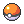 Poke Ball              |  | Marts | Pinball RS |
| 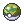 Safari Ball            |  | Safari Zone |  |
| 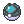 Net Ball               |  | Rustboro Mart, Mossdeep Mart |  |
|  Dive Ball              |  | Fallarbor Mart, Mossdeep Mart |  |
|  Nest Ball              |  | Verdanturf Mart |  |
|  Repeat Ball            |  | Rustboro Mart |  |
| 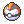 Timer Ball             |  | Rustboro Mart |  |
| 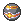 Luxury Ball            | Mauville Hills 3F  (1) | Verdanturf Mart |  |
|  Premier Ball           |  | Buy 10 or more Poké Balls at once |  |
| 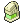 Full Restore           |  | Secret Pals Pickup  (1/32), Ever Grande Mart | Battle Frontier Mart |
| 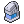 Max Potion             |  | Lilycove Dept. Store, Ever Grande Mart | Battle Frontier Mart |
|  Revive                 |  | Various, Rock Smash, Pickup |  |
|  Max Revive             |  | Rock Smash, Pickup, Lottery  (4 digit match), Secret Pals Pickup  (1/64) |  |
| 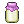 Moomoo Milk            |  | Lavaridge, Lottery  (1 digit match) |  |
|  Energy Powder          |  | Lavaridge Herb Shop |  |
| 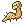 Energy Root            |  | Lavaridge Herb Shop |  |
|  Heal Powder            |  | Lavaridge Herb Shop |  |
| 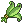 Revival Herb           | Dewford Shore  (1) | Lavaridge Herb Shop |  |
| 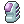 Ether                  |  | Various, Rock Smash |  |
|  Max Ether              |  | Various, Rock Smash |  |
| 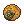 Lava Cookie            |  | Mt. Chimney |  |
| 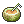 Berry Juice            |  | Shuckle |  |
| 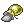 Sacred Ash             | Ho-Oh  (1), Navel Rock  (1) |  |  |
| 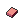 Red Shard              |  | Corsola, Octillery, Mirage Caves |  |
|  Blue Shard             |  | Clamperl, Mirage Caves |  |
|  Yellow Shard           |  | Chinchou, Lanturn, Mirage Caves |  |
| 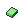 Green Shard            |  | Relicanth, Mirage Caves |  |
| 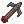 Eon Flute              |  | Steven  (Sootopolis) |  |
| 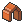 Protector              |  | Magma Hideout, Hariyama | Frontier Exchange |
| 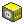 Electirizer            |  | Frontier Exchange |  |
| 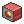 Magmarizer             |  | Frontier Exchange |  |
| 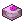 Dubious Disc           |  | Frontier Exchange |  |
| 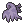 Reaper Cloth           | Mossdeep City  (1) | Shuppet, Frontier Exchange |  |
|  Ability Capsule        | Mauville (1) | Ritzy Retail Remedies  (Mauville), Trainer Hill  (Expert mode) | Frontier Exchange, Battle Palace, Wally (Rematch) |
|  Ability Patch          | Mauville (1) | Ritzy Retail Remedies  (Mauville) | Frontier Exchange, Battle Arena |
|  Hp Up                  |  | Slateport Market, Lilycove Dept. Store | Battle Frontier, Ninetails Noodles |
| 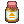 Protein                |  | Slateport Market, Lilycove Dept. Store | Battle Frontier, Ninetails Noodles |
| 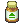 Iron                   |  | Slateport Market, Lilycove Dept. Store | Battle Frontier, Ninetails Noodles |
|  Carbos                 |  | Slateport Market, Lilycove Dept. Store | Battle Frontier, Ninetails Noodles |
| 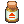 Calcium                |  | Slateport Market, Lilycove Dept. Store | Battle Frontier, Ninetails Noodles |
| 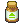 Zinc                   |  | Slateport Market, Lilycove Dept. Store | Battle Frontier, Ninetails Noodles |
| 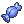 Rare Candy             |  | Various, Inverse Battle Stop | Ninetails Noodles (Doduo Omelette) |
|  Pp Up                  |  | Various, Pickup, Lottery  (2 digit match), Secret Pals Pickup  (1/128), Trainer Hill |  |
|  Pp Max                 |  | Various, Pickup, Lottery  (3 digit match), Secret Pals Pickup  (1/256), Trainer Hill  (Unique mode) | Battle Palace/Arena |
| 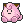 Poke Doll              |  | Trainer Hill  (Variety mode), Lilycove Department Store |  |
| 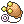 Fluffy Tail            |  | Trainer Hill, Lilycove Department Store |  |
| 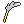 Poke Toy               |  | Lilycove Department Store |  |
|  Max Repel              |  | Lilycove Dept. Store, Ever Grande Mart, Battle Frontier Mart |  |
|  Escape Rope            |  | Marts, Secret Pals Pickup  (1/6) |  |
| 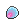 Prism Scale            |  | Feebas  (on varying/moving tile) | Wallace (After defeated in a Contest) |
| 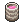 Sweet Tea              | Lavaridge Herb Shop  (1) | Jigglypuff |  |
| 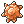 Sun Stone              | Mossdeep  (1) | Solrock, Sunkern, Secret Pals Stones, Inverse Battle Stop | Frontier Exchange |
| 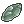 Moon Stone             | Dewford Shore  (1), Meteor Falls  (1) | Clefairy, Lunatone, Secret Pals Stones, Inverse Battle Stop, Mauville Hills  (Monday) | Frontier Exchange |
| 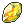 Fire Stone             | Fiery Path  (1) | Route 124  (Shard Hunter), Secret Pals Stones, Inverse Battle Stop, Mauville Hills  (Tuesday) | Frontier Exchange |
| 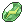 Thunder Stone          | New Mauville  (1) | Route 124  (Shard Hunter), Secret Pals Stones, Inverse Battle Stop, Mauville Hills  (Thursday) | Frontier Exchange |
| 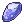 Water Stone            | Abandoned Ship  (1) | Route 124  (Shard Hunter), Secret Pals Stones, Inverse Battle Stop, Mauville Hills  (Wednesday) | Frontier Exchange |
| 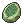 Leaf Stone             | Route 119  (1) | Route 124  (Shard Hunter), Secret Pals Stones, Inverse Battle Stop, Mauville Hills  (Saturday) | Frontier Exchange |
| 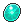 Dawn Stone             | Verdanturf  (1, Wally's uncle after defeating Flannery), Wally  (1) | Beautifly, Secret Pals Stones, Inverse Battle Stop | Frontier Exchange |
| 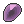 Dusk Stone             |  | Duskull, Secret Pals Stones, Inverse Battle Stop | Frontier Exchange |
| 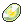 Shiny Stone            | Lanette's house  (1), Route 121  (1) | Mareep, Secret Pals Stones, Inverse Battle Stop | Frontier Exchange |
| 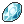 Ice Stone              | Ice Oasis  (1) | Secret Pals Stones, Inverse Battle Stop, Mauville Hills  (Friday) | Frontier Exchange |
| 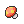 Tiny Mushroom          |  | Mirage Forests |  |
| 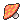 Big Mushroom           |  | Mirage Forests |  |
|  Pearl                  |  | Rock Smash, Mirage Islands, Secret Pals Treasure  (15%) |  |
|  Big Pearl              |  | Various, Clamperl, Rock Smash, Mirage Islands, Secret Pals Treasure  (10%) |  |
| 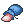 Stardust               |  | Staryu |  |
|  Star Piece             |  | Staryu, Rock Smash |  |
|  Nugget                 | Mauville Hills 3F  (1) | Secret Pals Treasure  (10%) |  |
|  Heart Scale            |  | Various, Luvdisc, Pickup, Rock Smash, Mirage Islands, Secret Pals Pickup  (1/8) |  |
|  Big Nugget             | Abandoned Ship  (1), Trick House  (1) | Mirage Mountains, Secret Pals Treasure  (5%) |  |
|  Pearl String           |  | Secret Pals Treasure  (10%) |  |
|  Comet Shard            | Dewford Shore  (1) | Mirage Mountains, Secret Pals Treasure  (5%) | Delta Meteor (1) |
|  Bottle Cap             |  |  | Ritzy Retail Remedies (Mauville), Bottle Cap Man (Ninetails Noodles) |
|  Gold Bottle Cap        |  |  | Ritzy Retail Remedies (Mauville) |
|  Rare Bone              |  | Secret Pals Treasure  (15%) |  |
| 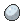 Oval Stone             |  | Mirage Mountains | Happiny |
| 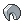 Razor Claw             |  | Zangoose, Mirage Forests | Frontier Exchange |
| 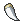 Razor Fang             | Meteor Falls (1) | Zubat, Seviper, Mirage Forests | Frontier Exchange |
| 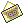 Orange Mail            | Trick House 1  (1) | Petalburg Mart |  |
| 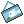 Harbor Mail            | Starting mailbox  (1), Trick House 2  (1), Abandoned Ship  (1) | Slateport Mart |  |
|  Glitter Mail           | Trick House 6  (1) |  | Battle Frontier Mart |
|  Mech Mail              | Trick House 4  (1) | Lilycove Department Store |  |
|  Wood Mail              | Trick House 3  (1) | Fortree Mart |  |
|  Wave Mail              | Trick House 2  (1) | Lilycove Department Store |  |
|  Bead Mail              | Trick House 8  (1) |  | Battle Frontier Mart |
|  Shadow Mail            | Trick House 3  (1) | Sootopolis Mart |  |
|  Tropic Mail            |  | Trick House 7 | Battle Frontier Mart |
|  Dream Mail             |  |  | Zinnia (1) |
|  Cheri Berry            |  | Route 103, 104, Pretty Petal Flower Shop, Berry Master's wife, Lilycove Berry Gentleman |  |
|  Chesto Berry           |  | Route 103, 104, 116, 121, DOTS, Whismur, Loudred, Spinda, Pretty Petal Flower Shop, Berry Master's wife, Lilycove Berry Gentleman |  |
|  Pecha Berry            |  | Route 102, 104, 112, 120, 123, Pretty Petal Flower Shop, Poochyena, Mightyena, Berry Master's wife, Lilycove Berry Gentleman |  |
|  Rawst Berry            |  | Route 104, 112, 121, 123, Vulpix, Numel, Pretty Petal Flower Shop, Berry Master's wife, Lilycove Berry Gentleman |  |
|  Aspear Berry           |  | Route 120, 121, Pretty Petal Flower Shop, Berry Master's wife, Lilycove Berry Gentleman |  |
|  Leppa Berry            |  | Route 103, 104, 110, 119, 123, Skitty, Pretty Petal Flower Shop. Berry Master's wife, Lilycove Berry Gentleman |  |
|  Oran Berry             |  | Route 102, 104, 111, Inverse Battle Stop, Shuckle, Pikachu, Linoone, Zigzagoon, Pretty Petal Flower Shop, Berry Master's wife, Lilycove Berry Gentleman |  |
|  Persim Berry           |  | Route 114, 121, Pretty Petal Flower Shop, Girafarig, Kecleon, Berry Master's wife, Lilycove Berry Gentleman |  |
|  Lum Berry              |  | Route 118, 121, Berry Master's Garden, Mew, Berry Master's wife, Lilycove Berry Gentleman |  |
|  Sitrus Berry           |  | Route 116, 118, 119, 123, Inverse Battle Stop, Berry Master's wife, Lilycove Berry Gentleman, Linoone, Pokemon Jump |  |
|  Figy Berry             |  | Kiri, Route 120 Berry Beauty, Pokemon Jump |  |
|  Wiki Berry             |  | Berry Master's Garden, Route 120 Berry Beauty, Chaz  (4 Master Rank contests), Pokemon Jump |  |
|  Mago Berry             |  | Route 120 Berry Beauty, Chaz  (4 Master Rank contests), Pokemon Jump |  |
|  Aguav Berry            |  | Berry Master's Garden, Route 120 Berry Beauty, Pokemon Jump |  |
|  Iapapa Berry           |  | Kiri, Route 120 Berry Beauty, Pokemon Jump |  |
|  Razz Berry             |  | Route 111, 120, Route 114 man, Dodrio Berry Picking |  |
|  Bluk Berry             |  | Route 115, Route 114 man, Dodrio Berry Picking |  |
|  Nanab Berry            |  | Route 110, 120, 121, Route 114 man, Dodrio Berry Picking |  |
|  Wepear Berry           |  | Route 117, 120, Route 114 man, Dodrio Berry Picking |  |
|  Pinap Berry            |  | Route 116, 117, 120, Route 114 man, Dodrio Berry Picking |  |
|  Pomeg Berry            |  | Route 119, Berry Master's Garden, Berry Master, Kiri, Dodrio Berry Picking, Berry Mutations |  |
|  Kelpsy Berry           |  | Route 115, Berry Master, Kiri, Dodrio Berry Picking, Berry Mutations |  |
|  Qualot Berry           |  | Berry Master's Garden, Berry Master, Kiri, Dodrio Berry Picking, Berry Mutations |  |
|  Hondew Berry           |  | Route 119, Berry Master, Kiri, Dodrio Berry Picking, Berry Mutations |  |
|  Grepa Berry            |  | Berry Master's Garden, Berry Master, Kiri, Dodrio Berry Picking, Berry Mutations |  |
|  Tamato Berry           |  | Berry Master, Kiri, Dodrio Berry Picking, Berry Mutations |  |
|  Cornn Berry            |  | Berry Master, Kiri, Dodrio Berry Picking |  |
|  Magost Berry           |  | Berry Master, Kiri, Dodrio Berry Picking |  |
|  Rabuta Berry           |  | Berry Master, Kiri, Dodrio Berry Picking |  |
|  Nomel Berry            |  | Berry Master, Kiri, Dodrio Berry Picking |  |
|  Spelon Berry           |  | "GREAT BATTLE" password, Dodrio Berry Picking |  |
|  Pamtre Berry           |  | "CHALLENGE CONTEST" password, Dodrio Berry Picking |  |
|  Watmel Berry           |  | "OVERWHELMING LATIAS" password, Lilycove Quiz Lady, Dodrio Berry Picking |  |
|  Durin Berry            |  | "COOL LATIOS" password, Lilycove Quiz Lady, Dodrio Berry Picking |  |
|  Belue Berry            |  | "SUPER HUSTLE" password, Lilycove Quiz Lady, Dodrio Berry Picking |  |
|  Liechi Berry           |  | Mirage Island, Secret Pals Berries  (1/35), Berry Mutations |  |
|  Ganlon Berry           |  | Southern Island, Secret Pals Berries  (1/35), Berry Mutations |  |
|  Salac Berry            |  | Secret Pals Berries  (1/35), Berry Mutations |  |
|  Petaya Berry           |  | Faraway Island, Secret Pals Berries  (1/35), Berry Mutations |  |
|  Apicot Berry           |  | Faraway Island, Secret Pals Berries  (1/35), Berry Mutations |  |
|  Lansat Berry           |  | Secret Pals Berries  (1/35) | Scott (All silver Symbols) |
|  Starf Berry            |  | Secret Pals Berries  (1/35), Scott  (all gold Symbols) |  |
|  Enigma Berry           | Delta Meteor  (1) |  |  |
|  Bright Powder          |  | Volbeat, Illumise | Frontier Exchange |
|  White Herb             | Pretty Petal Flower Shop  (1) | Lavaridge Herb Shop | Frontier Exchange |
|  Macho Brace            |  | Winstrates | Frontier Exchange |
|  Exp Share              |  | Petalburg Woods |  |
|  Quick Claw             | Trainer School  (1) | Anorith, Zangoose, Slateport Battle Tent  (2/8) | Frontier Exchange |
|  Soothe Bell            | Pokémon Fan Club  (1) | Chimecho |  |
|  Mental Herb            | Fortree  (1) | Lavaridge Herb Shop | Frontier Exchange |
|  Choice Band            |  | Verdanturf Battle Tent  (1/8) | Frontier Exchange, Battle Palace/Arena |
|  Kings Rock             | Mossdeep  (1) | Hariyama | Frontier Exchange |
|  Silver Powder          |  | Masquerain, Beautifly, Dustox |  |
|  Amulet Coin            |  | Mom, Meowth |  |
|  Cleanse Tag            | Dewford Shore  (1), Mt. Pyre  (1) | Chingling |  |
|  Soul Dew               |  |  | Southern Island (Eon Ticket) |
|  Deep Sea Tooth         | Slateport Harbor  (1) | Carvanha, Sharpedo | Frontier Exchange |
|  Deep Sea Scale         | Slateport Harbor  (1) | Chinchou, Lanturn, Relicanth | Frontier Exchange |
|  Smoke Ball             | Trick House 4  (1) | Koffing, Ninja Boy Lao  (Rematch) |  |
|  Everstone              | Granite Cave  (1) | Geodude, Inverse Battle Stop |  |
|  Focus Band             | Shoal Cave  (1) | Machop, Fallarbor Battle Tent  (1/8) | Frontier Exchange |
|  Lucky Egg              |  | Pelipper | Ninetails Noodles (Doduo Omelette) |
|  Scope Lens             |  | Slateport Battle Tent  (1/8) | Frontier Exchange |
|  Metal Coat             |  | Magnemite, Magneton | Frontier Exchange |
|  Leftovers              | S.S. Tidal  (1) | Secret Base trash cans | Frontier Exchange, Battle Palace/Arena |
|  Dragon Scale           | Sky Pillar (1) | Horsea, Bagon, Mirage Mountains | Frontier Exchange |
|  Light Ball             | Route 120  (1) | Pikachu |  |
|  Soft Sand              | Route 109  (1) | Trapinch, Nincada, Rock Smash |  |
|  Hard Stone             | Trick House 3  (1) | Aron, Rock Smash, Route 114 |  |
|  Miracle Seed           | Petalburg Woods  (1) | Seedot |  |
|  Black Glasses          | Route 116  (1) | Absol |  |
|  Black Belt             |  | Makuhita |  |
|  Magnet                 | Trick House 6  (1) | Nosepass |  |
|  Mystic Water           |  | Castform, Goldeen |  |
|  Sharp Beak             | Dewford Shore  (1) | Doduo |  |
|  Poison Barb            |  | Cacnea, Tentacool, Roselia |  |
|  Never Melt Ice         | Shoal Cave  (1) | Mauville Hills, Snorunt |  |
|  Spell Tag              |  | Duskull, Shuppet |  |
|  Twisted Spoon          |  | Mauville Hills Old Guys, Abra |  |
|  Charcoal               | Lavaridge  (1) | Vulpix, Torkoal |  |
|  Dragon Fang            |  | Aerodactyl, Bagon |  |
|  Silk Scarf             | Dewford  (1) |  | Aipom |
|  Upgrade                |  |  | Frontier Exchange |
|  Shell Bell             |  | Shoal Salt & Shoal Shells |  |
|  Sea Incense            |  | Slateport Market |  |
|  Lax Incense            |  | Slateport Market |  |
|  Lucky Punch            |  |  | Happiny |
|  Metal Powder           |  | Ditto |  |
|  Quick Powder           |  | Ditto |  |
|  Odd Incense            |  | Slateport Market |  |
|  Rock Incense           |  | Slateport Market |  |
|  Full Incense           |  | Slateport Market |  |
|  Wave Incense           |  | Slateport Market |  |
|  Rose Incense           |  | Slateport Market |  |
|  Luck Incense           |  | Slateport Market |  |
|  Pure Incense           |  | Slateport Market |  |
|  Power Bracer           |  | Energy Guru |  |
|  Power Belt             |  | Energy Guru |  |
|  Power Lens             |  | Energy Guru |  |
|  Power Band             |  | Energy Guru |  |
|  Power Anklet           |  | Energy Guru |  |
|  Power Weight           |  | Energy Guru |  |
|  Power Herb             |  | Lavaridge Herb Shop | Frontier Exchange |
|  Choice Scarf           |  | Verdanturf Battle Tent  (1/8) | Frontier Exchange, Battle Palace/Arena |
|  Choice Specs           |  | Slateport Battle Tent  (1/8) | Frontier Exchange, Battle Palace/Arena |
|  Focus Sash             |  | Fallarbor Battle Tent  (2/8) | Frontier Exchange, Battle Palace/Arena |
|  Wide Lens              | Route 123  (1) | Sableye | Frontier Exchange |
|  Zoom Lens              |  | Prof. Cozmo's house | Frontier Exchange |
|  Metronome              | Mauville Hills 3F  (1) | Verdanturf Battle Tent  (2/8) |  |
|  Muscle Band            |  | Machop | Frontier Exchange |
|  Wise Glasses           |  | Abra | Frontier Exchange |
|  Expert Belt            |  | Trick House, Fallarbor Battle Tent  (1/8) | Frontier Exchange |
|  Throat Spray           | Rusturf Tunnel  (1) | Loudred, Contest Dressing Room | Frontier Exchange |
|  Eject Pack             |  |  | Frontier Exchange |
|  Heavy Duty Boots       | Underwater Sealed Chamber  (1) | Mirage Mountains | Frontier Exchange |
|  Blunder Policy         |  | Spinda, Verdanturf Battle Tent  (4/8) | Frontier Exchange |
|  Ss Ticket              |  | Norman  (after DE) |  |
|  Red Orb                |  | Mt. Pyre  (Delta Episode) |  |
|  Blue Orb               |  | Mt. Pyre  (Delta Episode) |  |
|  Root Fossil            | Mirage Tower  (1) | Rock Smash  (Mirage Spots) | Desert Underpass (1) |
|  Claw Fossil            | Mirage Tower  (1) | Rock Smash  (Mirage Spots) | Desert Underpass (1) |
|  TM01 Focus Punch       |  | Route 115 |  |
|  TM02 Dragon Claw       |  | Meteor Falls |  |
|  TM03 Water Pulse       |  | Juan |  |
|  TM04 Calm Mind         |  | Tate & Liza |  |
|  TM05 Roar              |  | Route 114 |  |
|  TM06 Toxic             |  | Fiery Path |  |
|  TM07 Hail              |  | Shoal Cave |  |
|  TM08 Bulk Up           |  | Brawly |  |
|  TM09 Bullet Seed       |  | Route 104 |  |
|  TM10 Hidden Power      |  | Fortree City |  |
|  TM11 Sunny Day         |  | Scorched Slab |  |
|  TM12 Taunt             |  | Trick House 1 |  |
|  TM13 Ice Beam          |  | Abandoned Ship, Mauville Game Corner |  |
|  TM14 Blizzard          |  | Lilycove Department Store |  |
|  TM15 Hyper Beam        |  | Lilycove Department Store, Lilycove Ladies |  |
|  TM16 Light Screen      |  | Lilycove Department Store |  |
|  TM17 Protect           |  | Lilycove Department Store |  |
|  TM18 Rain Dance        |  | Abandoned Ship |  |
|  TM19 Giga Drain        |  | Route 123 |  |
|  TM20 Safeguard         |  | Lilycove Department Store |  |
|  TM21 Frustration       |  | Pacifidlog Town |  |
|  TM22 Solar Beam        |  | Safari Zone |  |
|  TM23 Iron Tail         |  | Meteor Falls |  |
|  TM24 Thunderbolt       |  | Mauville City |  |
|  TM25 Thunder           |  | Lilycove Department Store |  |
|  TM26 Earthquake        |  | Seafloor Cavern |  |
|  TM27 Return            |  | Pacifidlog Town |  |
|  TM28 Dig               |  | Fossil Maniac's House |  |
|  TM29 Psychic           |  | Victory Road |  |
|  TM30 Shadow Ball       |  | Mt. Pyre |  |
|  TM31 Brick Break       |  | Sootopolis City |  |
|  TM32 Double Team       |  | Route 113 |  |
|  TM33 Reflect           |  | Lilycove Department Store |  |
|  TM34 Shock Wave        |  | Mauville |  |
|  TM35 Flamethrower      |  | Victory Road |  |
|  TM36 Sludge Bomb       |  | Dewford Town |  |
|  TM37 Sandstorm         |  | Route 111 |  |
|  TM38 Fire Blast        |  | Lilycove Department Store |  |
|  TM39 Rock Tomb         |  | Roxanne |  |
|  TM40 Aerial Ace        |  | Mauville |  |
|  TM41 Torment           |  | Slateport |  |
|  TM42 Facade            |  | Facade |  |
|  TM43 Secret Power      |  | Route 111 |  |
|  TM44 Rest              |  | Lilycove |  |
|  TM45 Attract           |  | Verdanturf |  |
|  TM46 Thief             |  | Oceanic Museum |  |
|  TM47 Steel Wing        |  | Granite Cave |  |
|  TM48 Skill Swap        |  | Mt. Pyre |  |
|  TM49 Snatch            |  | S.S. Tidal |  |
|  TM50 Overheat          |  | Flannery |  |
|  Hm01 Cut               |  | Rustboro |  |
|  Hm02 Fly               |  | Route 119 |  |
|  Hm03 Surf              |  | Petalburg |  |
|  Hm04 Strength          |  | Rusturf Tunnel |  |
|  Hm05 Flash             |  | Granite Cave |  |
|  Hm06 Rock Smash        |  | Mauville City Courtyard  (Rock Smash Dude) |  |
|  Hm07 Waterfall         |  | Sootopolis |  |
|  Hm08 Dive              |  | Mossdeep |  |
|  Mega Bracelet          |  | Southern Island  (steven) |  |
|  Old Amber              |  | Rock Smash  (Mirage Spots) |  |
|  Helix Fossil           |  | Rock Smash  (Mirage Spots) |  |
|  Dome Fossil            |  | Rock Smash  (Mirage Spots) |  |
|  Dusk Ball              | Rusturf Tunnel  (1) | Fallarbor Mart |  |
|  Heal Ball              |  | Verdanturf Mart |  |
|  Quick Ball             |  | Fallarbor Mart |  |
|  Occa Berry             |  | Berry Master's Garden, Route 111 girl, Inverse Battle Stop |  |
|  Passho Berry           |  | Berry Master's Garden, Route 111 girl, Inverse Battle Stop |  |
|  Wacan Berry            |  | Berry Master's Garden, Route 111 girl, Inverse Battle Stop |  |
|  Rindo Berry            |  | Berry Master's Garden, Route 111 girl, Inverse Battle Stop |  |
|  Yache Berry            |  | Berry Master's Garden, Route 111 girl, Inverse Battle Stop |  |
|  Chople Berry           |  | Berry Master's Garden, Route 111 girl, Inverse Battle Stop |  |
|  Kebia Berry            |  | Berry Master's Garden, Route 111 girl, Inverse Battle Stop |  |
|  Shuca Berry            |  | Berry Master's Garden, Route 111 girl, Inverse Battle Stop |  |
|  Coba Berry             |  | Berry Master's Garden, Route 111 girl, Inverse Battle Stop |  |
|  Payapa Berry           |  | Berry Master's Garden, Route 111 girl, Inverse Battle Stop |  |
|  Tanga Berry            |  | Berry Master's Garden, Route 111 girl, Inverse Battle Stop |  |
|  Charti Berry           |  | Berry Master's Garden, Route 111 girl, Inverse Battle Stop |  |
|  Kasib Berry            |  | Berry Master's Garden, Route 111 girl, Inverse Battle Stop |  |
|  Haban Berry            |  | Berry Master's Garden, Route 111 girl, Inverse Battle Stop |  |
|  Colbur Berry           |  | Berry Master's Garden, Route 111 girl, Inverse Battle Stop |  |
|  Babiri Berry           |  | Berry Master's Garden, Route 111 girl, Inverse Battle Stop |  |
|  Chilan Berry           |  | Berry Master's Garden, Route 111 girl, Inverse Battle Stop |  |
|  Roseli Berry           |  | Berry Master's Garden, Route 111 girl, Inverse Battle Stop |  |
|  Micle Berry            |  | Trackless Forest  (Raikou) |  |
|  Custap Berry           |  | Mirage Forests, Trackless Forest  (Entei) |  |
|  Rowap Berry            |  | Trackless Forest  (Suicune) |  |
|  Kee Berry              |  | Southern Island, Secret Pals Berries  (1/35), Berry Mutations |  |
|  Maranga Berry          |  | Southern Island, Secret Pals Berries  (1/35), Berry Mutations |  |
|  Lonely Mint            | Mauville 1F | Trainer Hill  (Variety) | Battle Palace, Frontier Exchange, Ninetails Noodles |
|  Adamant Mint           | Mauville 1F | Trainer Hill  (Variety) | Battle Palace, Frontier Exchange, Ninetails Noodles |
|  Naughty Mint           | Mauville 1F | Trainer Hill  (Variety) | Battle Palace, Frontier Exchange, Ninetails Noodles |
|  Brave Mint             | Mauville 1F | Trainer Hill  (Variety) | Battle Palace, Frontier Exchange, Ninetails Noodles |
|  Bold Mint              | Mauville 1F | Trainer Hill  (Variety) | Battle Palace, Frontier Exchange, Ninetails Noodles |
|  Impish Mint            | Mauville 1F | Trainer Hill  (Variety) | Battle Palace, Frontier Exchange, Ninetails Noodles |
|  Lax Mint               | Mauville 1F | Trainer Hill  (Variety) | Battle Palace, Frontier Exchange, Ninetails Noodles |
|  Relaxed Mint           | Mauville 1F | Trainer Hill  (Variety) | Battle Palace, Frontier Exchange, Ninetails Noodles |
|  Modest Mint            | Mauville 1F | Trainer Hill  (Variety) | Battle Palace, Frontier Exchange, Ninetails Noodles |
|  Mild Mint              | Mauville 1F | Trainer Hill  (Variety) | Battle Palace, Frontier Exchange, Ninetails Noodles |
|  Rash Mint              | Mauville 1F | Trainer Hill  (Variety) | Battle Palace, Frontier Exchange, Ninetails Noodles |
|  Quiet Mint             | Mauville 1F | Trainer Hill  (Variety) | Battle Palace, Frontier Exchange, Ninetails Noodles |
|  Calm Mint              | Mauville 1F | Trainer Hill  (Variety) | Battle Palace, Frontier Exchange, Ninetails Noodles |
|  Gentle Mint            | Mauville 1F | Trainer Hill  (Variety) | Battle Palace, Frontier Exchange, Ninetails Noodles |
|  Careful Mint           | Mauville 1F | Trainer Hill  (Variety) | Battle Palace, Frontier Exchange, Ninetails Noodles |
|  Sassy Mint             | Mauville 1F | Trainer Hill  (Variety) | Battle Palace, Frontier Exchange, Ninetails Noodles |
|  Timid Mint             | Mauville 1F | Trainer Hill  (Variety) | Battle Palace, Frontier Exchange, Ninetails Noodles |
|  Hasty Mint             | Mauville 1F | Trainer Hill  (Variety) | Battle Palace, Frontier Exchange, Ninetails Noodles |
|  Jolly Mint             | Mauville 1F | Trainer Hill  (Variety) | Battle Palace, Frontier Exchange, Ninetails Noodles |
|  Naive Mint             | Mauville 1F | Trainer Hill  (Variety) | Battle Palace, Frontier Exchange, Ninetails Noodles |
|  Serious Mint           | Mauville 1F | Trainer Hill  (Variety) | Battle Palace, Frontier Exchange, Ninetails Noodles |
|  Toge Timer             | Route 117 Daycare  (1) |  |  |
|  Light Clay             |  | Baltoy, Claydol | Frontier Exchange |
|  Icy Rock               |  | Weather Institute |  |
|  Smooth Rock            |  | Weather Institute |  |
|  Heat Rock              |  | Weather Institute |  |
|  Damp Rock              |  | Weather Institute |  |
|  Destiny Knot           |  | Pickup, Southern Island, Chaz  (Win 4 Master Rank Contests) |  |
|  Grip Claw              |  | Kabuto, Sandshrew | Frontier Exchange |
|  Life Orb               |  |  | Frontier Exchange |
|  Toxic Orb              |  |  | Frontier Exchange |
|  Flame Orb              |  |  | Frontier Exchange |
|  Sticky Barb            |  | Cacnea |  |
|  Black Sludge           |  | Grimer |  |
|  Iron Ball              |  | Pickup, Mawile | Frontier Exchange |
|  Lagging Tail           |  | Slakoth |  |
|  Shed Shell             |  | Seviper |  |
|  Big Root               | Route 120  (1) | Lileep |  |
|  Eviolite               | Route 123 Go Fish Shop  (1) | Mirage Caves |  |
|  Float Stone            | Rustboro City  (1) | Secret Pals Treasure  (30%) |  |
|  Rocky Helmet           | Weather Institute  (1) |  | Frontier Exchange |
|  Air Balloon            |  |  | Frontier Exchange |
|  Red Card               |  | Fallarbor Battle Tent  (3/8) | Frontier Exchange |
|  Ring Target            |  |  | Frontier Exchange |
|  Binding Band           |  | Omanyte | Frontier Exchange |
|  Eject Button           |  |  | Frontier Exchange |
|  Absorb Bulb            |  | Oddish, Gloom | Frontier Exchange |
|  Cell Battery           |  | Plusle, Minun | Frontier Exchange |
|  Luminous Moss          |  | Galarian Corsola | Frontier Exchange |
|  Snowball               | Ice Oasis  (1) | Snorunt | Frontier Exchange |
|  Weakness Policy        |  | Slateport Battle Tent  (4/8) | Frontier Exchange |
|  Assault Vest           |  |  | Frontier Exchange, Battle Palace/Arena |
|  Safety Goggles         | Route 111  (1) |  | Frontier Exchange |
|  Terrain Extender       |  | Trainer Hill  (Normal mode) | Frontier Exchange |
|  Protective Pads        |  |  | Frontier Exchange |
|  Electric Seed          |  | Mareep |  |
|  Psychic Seed           |  | Spoink |  |
|  Misty Seed             |  | Koffing |  |
|  Grassy Seed            |  | Oddish |  |
|  Room Service           |  | Covelily Motel | Frontier Exchange |
|  Utility Umbrella       | Route 120  (1) |  | Frontier Exchange |
|  Miloticite             |  |  | Defeat Wallace & Lisia in a Contest (1), Frontier Exchange |
|  Lucarionite            |  |  | Chaz after defeating Lisia in a Contest (1), Frontier Exchange |
|  Normal Gem             |  | Rock Smash |  |
|  Absolite               | Safari Zone  (1) |  | Frontier Exchange |
|  Aerodactylite          |  |  | Meteor Falls (1), Frontier Exchange |
|  Aggronite              | Verdanturf  (1) |  | Frontier Exchange |
|  Alakazite              | Slateport  (1) |  | Frontier Exchange |
|  Altarianite            | Lilycove  (1) |  | Frontier Exchange |
|  Ampharosite            | New Mauville  (1) |  | Frontier Exchange |
|  Banettite              | Mt. Pyre  (1) |  | Frontier Exchange |
|  Beedrillite            |  |  | Frontier Exchange |
|  Blastoisinite          |  |  | Frontier Exchange |
|  Blazikenite            | Route 120  (1) | Route 114 | Frontier Exchange |
|  Cameruptite            |  |  | Maxie (1), Frontier Exchange |
|  Charizardite X         |  |  | Frontier Exchange |
|  Charizardite Y         |  |  | Frontier Exchange |
|  Galladite              |  |  | Prof. Cozmo (1), Frontier Exchange |
|  Gardevoirite           | Wanda  (1) |  | Frontier Exchange |
|  Gengarite              |  |  | Frontier Exchange |
|  Glalitite              | Shoal Cave  (1) |  | Frontier Exchange |
|  Gyaradosite            | Route 123 Go Fish Shop  (1) |  | Frontier Exchange |
|  Heracronite            | Route 127  (1) |  | Frontier Exchange |
|  Houndoominite          | Mt. Chimney  (1) |  | Frontier Exchange |
|  Kangaskhanite          |  |  | Frontier Exchange |
|  Latiasite              | Latias  (1) |  | Frontier Exchange |
|  Latiosite              | Latios  (1) |  | Frontier Exchange |
|  Manectite              | Seaside Cycling Road  (1) |  | Frontier Exchange |
|  Mawilite               | Verdanturf  (1) |  | Frontier Exchange |
|  Medichamite            | Mt. Pyre 6F  (1) |  | Frontier Exchange |
|  Metagrossite           |  |  | Steven (Rematch) |
|  Mewtwonite X           |  |  | Frontier Exchange |
|  Mewtwonite Y           |  |  | Frontier Exchange |
|  Pidgeotite             |  |  | Frontier Exchange |
|  Pinsirite              | Route 124  (1) |  | Frontier Exchange |
|  Sablenite              | Sootopolis  (1) |  | Frontier Exchange |
|  Salamencite            |  |  | Meteor Falls (1), Frontier Exchange |
|  Sceptilite             | Route 120  (1) | Route 114 | Frontier Exchange |
|  Scizorite              |  |  | Frontier Exchange |
|  Sharpedonite           |  |  | Archie (1), Frontier Exchange |
|  Slowbronite            |  |  | Frontier Exchange |
|  Steelixite             |  |  | Jasmine (1), Frontier Exchange |
|  Swampertite            | Route 120  (1) | Route 114 | Frontier Exchange |
|  Tyranitarite           |  |  | Jagged Pass (1), Frontier Exchange |
|  Venusaurite            |  |  | Frontier Exchange |
|  Shiny Charm            |  |  | Prof. Birch (Complete Hoenn Pokédex) |
|  Oval Charm             |  |  | Prof. Birch (See Hoenn Pokédex) |
|  TM51 Low Sweep         | Mauville Mart  (1) |  |  |
|  TM52 Focus Blast       | Lilycove Department Store  (1) |  |  |
|  TM53 Energy Ball       | Safari Zone  (1) |  |  |
|  TM54 False Swipe       | Rustboro Mart  (1) |  |  |
|  TM55 Scald             | Seafloor Cavern  (1) |  |  |
|  TM56 Fling             | Pacifidlog Town  (1) |  |  |
|  TM57 Charge Beam       | Mauville Mart  (1) |  |  |
|  TM58 Sky Drop          | Mauville Mart  (1) |  |  |
|  TM59 Incinerate        | Mt. Chimney  (1) |  |  |
|  TM60 Psyshock          | Pacifidlog Town  (1) |  |  |
|  TM61 Will O Wisp       | Mt. Pyre Exterior  (1) |  |  |
|  TM62 Acrobatics        | Route 119  (1) |  |  |
|  TM63 Embargo           | Lilycove Department Store Artist  (1) |  |  |
|  TM64 Explosion         | Sky Pillar  (1) |  |  |
|  TM65 Shadow Claw       | Granite Cave  (1) |  |  |
|  TM66 Payback           | Prof. Cozmo  (1) |  |  |
|  TM67 Retaliate         | Slateport Market  (1) |  |  |
|  TM68 Giga Impact       | Lilycove Department Store  (1) |  |  |
|  TM69 Rock Polish       | Jagged Pass  (1) |  |  |
|  TM70 Roost             | Winona  (1) |  |  |
|  TM71 Stone Edge        | Lilycove Department Store  (1) |  |  |
|  TM72 Volt Switch       | Wattson  (1) |  |  |
|  TM73 Thunder Wave      | Slateport Market  (1) |  |  |
|  TM74 Gyro Ball         | New Mauville  (1) |  |  |
|  TM75 Dragon Pulse      | Victory Road  (1) |  |  |
|  TM76 Leech Life        | Slateport Market  (1) |  |  |
|  TM77 Drain Punch       | Route 133  (1) |  |  |
|  TM78 Bulldoze          | Mauville Mart  (1) |  |  |
|  TM79 Frost Breath      | Shoal Cave  (1) |  |  |
|  TM80 Rock Slide        | Route 134  (1) |  |  |
|  TM81 X Scissor         | Victory Road  (1) |  |  |
|  TM82 Dragon Tail       | Mauville Mart  (1) |  |  |
|  TM83 Infestation       | Sootopolis Mart  (1) |  |  |
|  TM84 Poison Jab        | Abandoned Ship  (1) |  |  |
|  TM85 Stealth Rock      | Route 115 Mirage Cave  (1) |  |  |
|  TM86 Grass Knot        | Fortree City  (1) |  |  |
|  TM87 Swagger           | Lilycove City Mirage Mountain  (1) |  |  |
|  TM88 Sleep Talk        | Lilycove City  (1) |  |  |
|  TM89 U Turn            | Seaside Cycling Road challenge  (1) |  |  |
|  TM90 Substitute        | Route 111 Mirage Forest  (1) |  |  |
|  TM91 Flash Cannon      | Granite Cave B1F  (1) |  |  |
|  TM92 Trick Room        | Trick House Puzzle 4  (1) |  |  |
|  TM93 Wild Charge       | Safari Zone  (1) |  |  |
|  TM94 Avalanche         | Ice Oasis  (1) |  |  |
|  TM95 Whirlpool         | Route 125 Mirage Island  (1) |  |  |
|  TM96 Nature Power      | Fiery Path  (1) |  |  |
|  TM97 Dark Pulse        | Magma Hideout  (1) |  |  |
|  TM98 Power Up Punch    | Mauville Mart  (1) |  |  |
|  TM99 Dazzling Gleam    | Route 123  (1) |  |  |
|  TM100 Confide          | Slateport Market  (1) |  |  |
|  TM101 Grassy Terrain   | Trainer Hill Normal mode  (1) |  |  |
|  TM102 Misty Terrain    | Trainer Hill Normal mode  (1) |  |  |
|  TM103 Electric Terrain | Trainer Hill Normal mode  (1) |  |  |
|  TM104 Psychic Terrain  | Trainer Hill Normal mode  (1) |  |  |
|  TM105 Mystical Fire    | Dewford Shore  (1) |  |  |
|  TM106 Electroweb       | Devon Corp 2F  (1) |  |  |
|  TM107 Teleport         | Mauville Game Corner  (1) |  |  |
|  TM108 Hurricane        | Lilycove Department Store  (1) |  |  |
|  TM109 Body Press       | Trainer Hill Expert mode  (1) |  |  |
|  TM110 Ally Switch      | Trainer Hill Variety mode  (1) |  |  |
|  Machro Bike            |  |  | Speak to 3 new trainers on Routes 111, 115, and 119 about bikes. Then speak to Rydel. |
